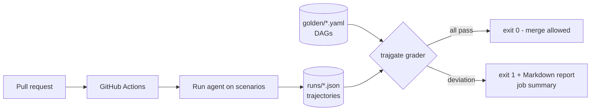

# trajectory-ci-gate

A GitHub Action + Python library that grades an agent's **tool-call trajectory** against a **golden DAG** — order constraints, required/forbidden tools, argument checks with data-flow references — and fails the PR on any deviation. Goes past final-answer gates: a PR can keep every final answer identical and still break the agent's process.

## What it is
- `trajgate` library: golden DAG spec (YAML), grader, Markdown/JSON report.
- `trajgate check` CLI: exits 1 on deviation, writes a PR-ready report and the GitHub job summary.
- `action.yml`: composite GitHub Action; `.github/workflows/trajectory-gate.yml` runs it on every PR.
- `sample_agent/`: a deterministic refund-support agent (rule-based, no LLM) with 7 tools and a `pr` variant that simulates a regression.
- `golden/`: 5 golden DAGs; `scenarios/`: 5 tasks.

## Why
Final-answer evals (see `eval-regression-lab`) miss process regressions: skipping identity verification, trusting a heuristic instead of the policy tool, refunding the wrong amount, calling a dangerous tool. Those are the failures that matter for agents with side effects.

## Architecture


## How it works
Golden DAG (excerpt of `golden/refund_small.yaml`):
```yaml
nodes:
  order:    {tool: get_order, args: {order_id: A100}}
  customer: {tool: lookup_customer, args: {customer_id: {ref: order.result.customer}}}
  verify:   {tool: verify_identity, args: {method: {in: [email_otp, sms_otp]}}}
  refund:   {tool: issue_refund, args: {amount: {ref: order.result.amount}}}
edges: [[order, customer], [customer, verify], [verify, refund], ...]
forbidden: [escalate_to_human]
allow_extra: false
max_calls: {issue_refund: 1}
```
The grader walks the DAG in topological order and binds each node to the earliest unused step that calls the right tool, satisfies the argument matchers (`equals`, `in`, `regex`, `gte`/`lte`, `any`, `absent`, `ref` to an earlier step's args/result) and comes after all predecessors. Unbound nodes become `missing_required`, `order_violation` or `arg_mismatch`; then it checks `forbidden_tool`, `unexpected_tool`, `max_calls` and `max_steps`. Branches without an edge may run in any order.

## Results
All numbers from [`results/mutation_eval.json`](results/mutation_eval.json) (`python -m scripts.mutation_eval`) and [`results/demo_pr_report.md`](results/demo_pr_report.md). Mutations are **synthetic** single edits of the sample agent's real trajectories; the final answer is unchanged in every mutant by construction, so a final-answer-only check catches 0.

| Check | Result |
|---|---|
| Main-branch agent vs golden | **5/5 tasks pass** |
| Mutants flagged by the gate | **102/107** |
| drop one step | 28/28 |
| corrupt one argument | 28/28 |
| duplicate one step | 28/28 |
| swap adjacent steps | 18/23 |
| Final-answer-only check | 0/107 (by construction) |

The 5 accepted mutants are all `verify_identity <-> check_refund_policy` swaps — those two branches have no ordering edge in the spec, so accepting them is correct.

**Demo PR scenario** (`variant="pr"`, a "fast path" that skips identity verification and the policy tool for orders under $100): final answers identical on **5/5** tasks; the gate fails **3/5** tasks with `missing_required` for `verify_identity` and `check_refund_policy`, and the CLI exits 1. The two passing tasks are orders over $100, where the fast path does not trigger.

## Tests
19 tests (`pytest -q`): main agent passes all goldens, each deviation kind, ref-based argument checks, permitted parallel reorder, optional nodes and matchers, cycle/bad-edge rejection, and the demo PR (identical answers, CLI exit 0 on main, exit 1 + report on PR, ungated/missing runs flagged).

```bash
pip install -e . pytest
pytest -q
python -m scripts.mutation_eval
python -m sample_agent.agent pr runs scenarios && trajgate check --golden golden --runs runs
```

## Limits
- Matching is greedy (earliest valid step per node, in topological order); a pathological trajectory could fail where a full bipartite search would pass.
- The sample agent is rule-based and deterministic; with an LLM agent you record trajectories per run and may need `min-score` < 1.0 or several samples per task.
- No OR-branches in the DAG yet (e.g. "either `sms_otp` or `email_otp` tool"); use `in` matchers on one tool instead.
- Golden DAGs are hand-written; there is no auto-induction from passing runs.

## License
MIT
